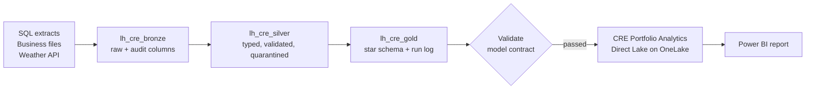
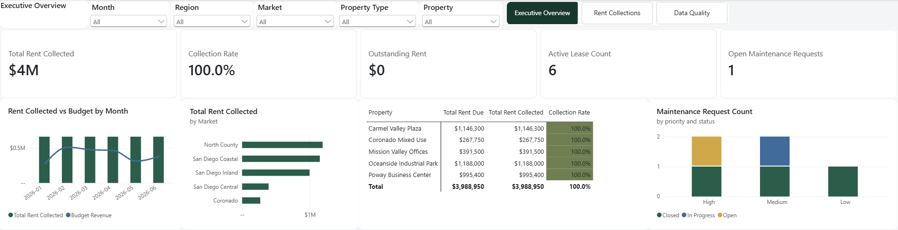
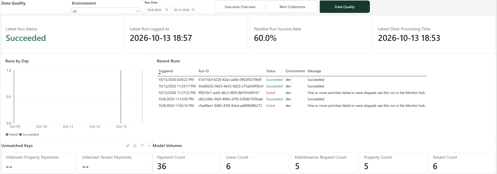
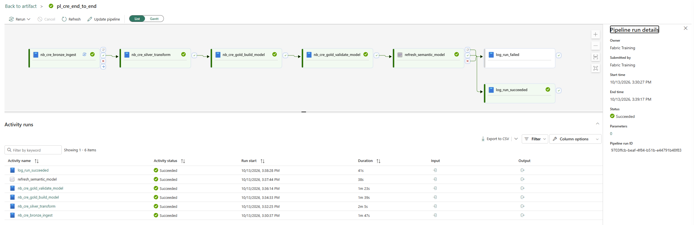
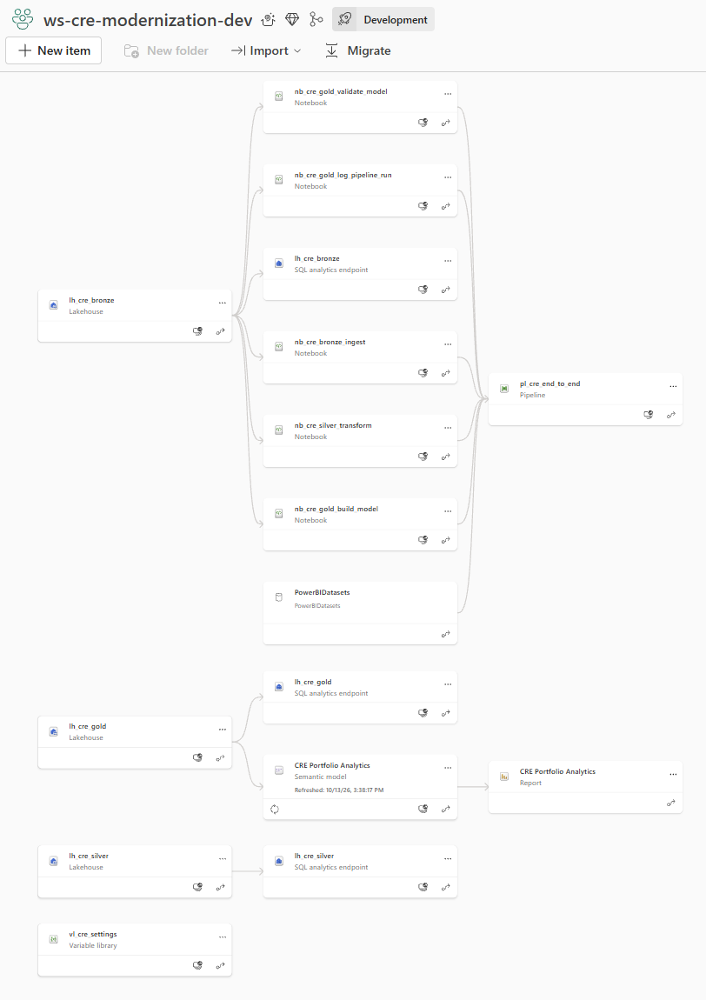
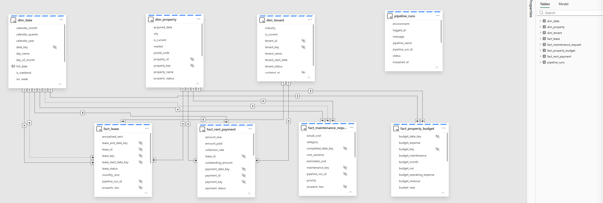
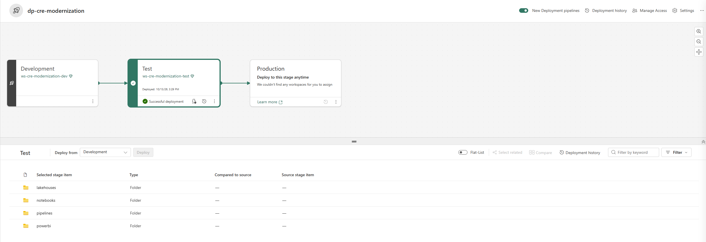

# Fabric Modern Data Platform

A Microsoft Fabric lakehouse for Commercial Real Estate operations and finance reporting. SQL extracts, business files, and API data move through Bronze, Silver, and Gold Lakehouses, are validated against a semantic-model contract, and are published through a Direct Lake model and a six-page Power BI report, promoted from Development to Test with Git versioning and a deployment pipeline.

## Architecture



`pl_cre_end_to_end` runs the medallion notebooks in one shared Spark session, validates Gold, refreshes the semantic model only when validation passes, and logs every run to `audit.pipeline_runs`, which the report's Data Quality page reads.

## Screenshots

| Executive Overview | Data Quality |
|---|---|
|  |  |

| Pipeline run | Workspace lineage |
|---|---|
|  |  |

| Semantic model | Deployment pipeline |
|---|---|
|  |  |

## Highlights

- **Validation gates the report.** Automatic Direct Lake updates are off; the model refreshes only after Gold passes its contract, so a bad load never reaches users.
- **Config-driven layers.** Column mappings, validation rules, grains, and relationships are configuration, not code.
- **Run-level lineage.** Every Bronze, Silver, and Gold row carries the pipeline's run ID.
- **Dev/Test/Prod by design.** Identical item names in every workspace, the Development workspace versioned in Azure DevOps, and per-stage values from a Variable library, since deployments copy pipeline IDs unchanged.
- **Tested before Fabric.** The notebooks run locally on Spark 4.1, the Fabric Runtime 2.0 version, with ANSI mode on and off.

## Documentation

| Document | Covers |
|---|---|
| [Project case study](docs/project-case-study.md) | The problem, the solution, engineering decisions, and business outcomes |
| [Architecture](docs/architecture.md) | Lakehouse layout, naming standard, each medallion layer, source-to-target mapping, semantic model design, and the planned incremental-load design |
| [Orchestration and operations](docs/operations.md) | Pipeline activities, run logging, retries, Spark session reuse, alerts, and failure triage |
| [Deployment and rollback](docs/deployment.md) | Dev/Test/Prod promotion, per-stage settings, post-deployment validation, and rollback |
| [Report page design](powerbi/report/report-pages.md) | The six report pages and their visuals |

## Repository Layout

| Folder | Contents |
|---|---|
| `notebooks/` | Fabric PySpark/Delta notebooks: Bronze ingestion, Silver transformation, Gold star schema, model validation, and run logging |
| `pipelines/` | The `pl_cre_end_to_end` activity specification |
| `config/` | The contracts the notebooks read: table layout, sources, Silver rules, Gold models, and the semantic-model contract |
| `powerbi/` | DAX measures with formats and display folders, report page design, and theme |
| `sql/` | Acceptance queries for the Silver and Gold SQL analytics endpoints |
| `deployment/` | Record of how each per-stage setting is applied in the deployment pipeline |
| `data/` | Sample source data, mirroring the Lakehouse `Files/landing/` folder |
| `tests/` | Contract tests and local PySpark runs of every notebook against the sample data |
| `docs/` | Case study, architecture, operations, deployment, and screenshots |

## Project Status

- **Development** (`ws-cre-modernization-dev`) runs `pl_cre_end_to_end` end to end: the medallion notebooks, validation, the semantic model refresh, and run logging. The six-page report is built, and the workspace is versioned in Azure DevOps.
- **Test** (`ws-cre-modernization-test`) is promoted through the deployment pipeline `dp-cre-modernization`, with stage values from the Variable library `vl_cre_settings`.
- **Production**, alerting, watermark-based incremental loads, and row-level security are designed in the docs and not yet built.

## Running the Tests

Requires Python 3.11 or later and Java 17 or 21.

```powershell
python -m venv .venv
.\.venv\Scripts\Activate.ps1
python -m pip install -r requirements-dev.txt
python -m pytest
```

## Technologies

Microsoft Fabric (Lakehouse, Notebooks, Data Pipelines, Variable libraries, deployment pipelines, Git integration), PySpark and Delta Lake, Power BI (Direct Lake, DAX), T-SQL, Azure DevOps, GitHub Actions, pytest.
