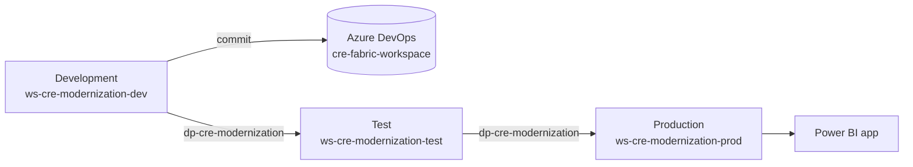

# Deployment and Rollback

How Fabric items move from Development to Test to Production, which settings differ by stage, and how a bad release is backed out.

## Workspace Topology

| Stage | Workspace | Lakehouses | Schedule |
|---|---|---|---|
| Development | `ws-cre-modernization-dev` | `lh_cre_bronze`, `lh_cre_silver`, `lh_cre_gold` | Disabled |
| Test | `ws-cre-modernization-test` | `lh_cre_bronze`, `lh_cre_silver`, `lh_cre_gold` | Disabled |
| Production | `ws-cre-modernization-prod` | `lh_cre_bronze`, `lh_cre_silver`, `lh_cre_gold` | Enabled after validation |

Item names and workspace folders are identical in every stage; the workspace carries the environment, which lets the deployment pipeline pair items automatically.

Only Development is connected to Git, through the Azure DevOps repository `cre-fabric-workspace` on `main`. Changes are made and run in Development, then committed from Fabric's **Source control** pane. Test and Production are never edited directly; they change only through the deployment pipeline `dp-cre-modernization`.

This GitHub repository is the reference implementation: notebooks, config, and DAX are built and tested here (CI runs every notebook locally on PySpark), then applied to the Development workspace.

## Per-Stage Settings

A deployment copies item definitions. Each setting that must differ by stage is applied as follows:

| Setting | How it is applied | Where it lives |
|---|---|---|
| Notebook default Lakehouse | Automatic rebinding to the stage's `lh_cre_bronze`; a **Default lakehouse** deployment rule if it doesn't happen | The deployment pipeline, on the target stage |
| Semantic model's `lh_cre_gold` (Direct Lake on OneLake) | Automatic rebinding once the stage's `lh_cre_gold` exists, so the model is deployed twice on a first deployment; a **Data source rules** deployment rule if it doesn't happen | The deployment pipeline, on the target stage |
| Pipeline `environment`, `workspace`, and `semantic-model` | Variable library `vl_cre_settings` with `test` and `prod` value sets | A workspace item; each stage selects its own active value set |
| Refresh connection | `conn_cre_semantic_model`, then `conn_cre_semantic_model_spn` (service principal) in every stage before Production | The tenant's **Manage connections and gateways** |
| Automatic Direct Lake updates (off) | Set by hand | Each stage's semantic model settings |
| Pipeline schedule | Set by hand | Production workspace only |

Deployment rules are not workspace items, and Fabric can't import them; they are created in the pipeline's interface by the item's owner, after the item has been deployed to that stage. [`deployment/deployment-rules.json`](../deployment/deployment-rules.json) records how each setting is applied so a new stage can be set up the same way, and a test keeps it in step with the notebooks.

No credentials are in either repository. Refreshes use tenant connections, and Production uses the service principal `app-cre-fabric-automation`, whose secret is kept outside source control.

## Promote Development to Test

1. Run `pl_cre_end_to_end` in Development and confirm every activity succeeds, including `refresh_semantic_model`.
2. Run [`sql/silver_acceptance_queries.sql`](../sql/silver_acceptance_queries.sql) in the `lh_cre_silver` SQL analytics endpoint, and [`sql/gold_acceptance_queries.sql`](../sql/gold_acceptance_queries.sql) and [`sql/semantic_model_validation.sql`](../sql/semantic_model_validation.sql) in the `lh_cre_gold` endpoint.
3. Check model relationships, DAX totals against the SQL queries, and report visuals; commit outstanding changes from **Source control**.
4. In `dp-cre-modernization`, compare Development and Test, and deploy the selected items.
5. On a first deployment, deploy the semantic model a second time, check every binding, and add deployment rules only where needed.
6. Confirm Test's `vl_cre_settings` active value set is `test`.
7. Run the Test pipeline against Test data and validate row counts, relationships, measures, filters, and report pages; confirm the run logged environment `test`.
8. Record the Azure DevOps commit, the deployment operation, and the validation result.

## Promote Test to Production

1. Confirm Test acceptance and business-owner approval, the Azure DevOps commit to roll back to if needed, and the support owner for the release.
2. Compare Test and Production, and deploy only the tested item set.
3. On a first deployment, deploy the semantic model a second time and check bindings.
4. Confirm Production's `vl_cre_settings` active value set is `prod`, and that `refresh_semantic_model` uses `conn_cre_semantic_model_spn`.
5. Keep the Production schedule disabled until smoke tests pass, then run post-deployment validation.
6. Enable the approved schedule, and publish or update the Power BI app for `sg-cre-portfolio-readers`.
7. Keep the release evidence: Azure DevOps commit, deployment operation, run ID, and validation results.

### Post-Deployment Validation

- The pipeline completes successfully.
- Bronze, Silver, and Gold row counts reconcile.
- Quarantine volume is within the accepted threshold.
- Gold business grains remain unique.
- Semantic-model relationships contain no orphans.
- DAX totals agree with the SQL acceptance queries.
- Direct Lake connectivity and report filters work.
- Workspace lineage shows the expected path.
- Alerts and ownership are configured ([Operations](operations.md#ownership-checklist)).

## Rollback

Fabric deployment pipelines have no one-click rollback: a rollback is a revert made in Development and promoted again.

**Triggers:** a failed Production run or semantic validation; a material row-count or financial reconciliation difference; a broken relationship or DAX result; incorrect report visuals; an item bound to another stage's Lakehouse or the wrong connection; performance beyond the accepted threshold.

### Containment

1. Turn off the `pl_cre_end_to_end` schedule in Production, so no new data reaches the report.
2. The report keeps showing the last validated data, because automatic Direct Lake updates are off and the model refreshes only after validation succeeds. If the bad release already refreshed the model, tell report users and, if needed, remove the app's audience until it is fixed.
3. Record the Azure DevOps commit, the deployment operation, the run ID, and the symptoms.

### Item Rollback

1. In `cre-fabric-workspace`, find the last known good commit and revert the faulty commit on `main`.
2. In Development, open **Source control** and select **Update all**, so the workspace matches the reverted state.
3. Run `pl_cre_end_to_end` in Development and validate.
4. Deploy the reverted items to Test, validate, then deploy to Production.
5. Confirm bindings, `vl_cre_settings` active value sets, and the refresh connection in each stage.

To roll back one item, revert just that item's directory and deploy only that item.

### Data Rollback

Rolling back items doesn't roll back data.

- The medallion tables are full loads, replaced on every run: rerun the pipeline after the item rollback.
- For a single table, Delta time travel restores a prior version: `RESTORE TABLE lh_cre_gold.leasing.fact_lease TO VERSION AS OF <n>`, after checking `DESCRIBE HISTORY`.
- For future incremental tables, restore a watermark only after confirming the target is consistent with it ([incremental load design](architecture.md#incremental-load-design-planned)).

Repeat the post-deployment validation, then turn the schedule back on and restore the app audience only after technical and business validation succeeds.
