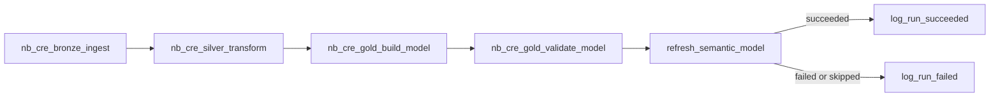

# Orchestration and Operations

How `pl_cre_end_to_end` runs the platform, and how failures are alerted on, triaged, and owned. [`pipelines/fabric-pipeline-manifest.json`](../pipelines/fabric-pipeline-manifest.json) is the pipeline's build specification; tests check that it matches the notebooks and their parameter cells.

## Activities



| Activity | Runs | Writes to | Runs when |
|---|---|---|---|
| `nb_cre_bronze_ingest` | Notebook | `lh_cre_bronze` | Pipeline starts |
| `nb_cre_silver_transform` | Notebook | `lh_cre_silver` | Bronze succeeded |
| `nb_cre_gold_build_model` | Notebook | `lh_cre_gold` | Silver succeeded |
| `nb_cre_gold_validate_model` | Notebook | (reads `lh_cre_gold`) | Gold succeeded |
| `refresh_semantic_model` | Semantic model refresh: **CRE Portfolio Analytics** | (the model) | Validation succeeded |
| `log_run_succeeded` | `nb_cre_gold_log_pipeline_run` | `lh_cre_gold` | Refresh succeeded |
| `log_run_failed` | `nb_cre_gold_log_pipeline_run` | `lh_cre_gold` | Refresh failed **or** was skipped |

Each notebook fails loudly before writing bad data (missing landing files, absent configured columns, grain violations, semantic contract failures), so the pipeline's success condition is the data-quality gate.

## Validation Gates the Report

The semantic model's automatic Direct Lake updates are turned off, so it changes only when `refresh_semantic_model` runs, and that runs only after `nb_cre_gold_validate_model` succeeds. Gold tables that fail validation never reach the report; it keeps the last validated data until a run passes.

## Run Logging

Every run writes exactly one row to `lh_cre_gold.audit.pipeline_runs`: run ID, pipeline name, environment, status, message, trigger time, log time, and run date (the UTC trigger date, for charting runs by day). New columns are appended with Delta schema merge, so an existing run log accepts them.

- `log_run_succeeded` depends on the refresh **succeeding**.
- `log_run_failed` depends on the refresh **failing or being skipped**. Two conditions on the same dependency are combined with OR, and any failure earlier in the chain skips the refresh, so this one activity catches every failed run without a dependency on each step.

This is the error-handling pattern Fabric pipelines inherit from Azure Data Factory. The run log lives in the Gold Lakehouse so the Direct Lake model can report pipeline health beside the business data.

## Retries

Every activity retries once after 120 seconds. The failures a retry fixes are transient: Spark session start-up errors, and a busy capacity rejecting the job (HTTP 430, `TooManyRequestsForCapacity`). A retry is safe because the medallion notebooks replace their tables, so rerunning never duplicates business data; at worst, a log activity that failed after writing its row logs the run twice. A genuine data or contract failure fails the retry the same way, about two minutes later.

## One Spark Session per Run

Every notebook uses `lh_cre_bronze` as its default Lakehouse and every activity carries the session tag `cre_pipeline`. With high concurrency for pipelines enabled, Fabric reuses a Spark session only between notebooks with the same default Lakehouse and session tag, so the whole run shares one session.

This was learned in the first Fabric runs. With each notebook defaulting to the Lakehouse it writes, every layer boundary needed a new session while the previous one still held compute, and the trial capacity rejected the new session with HTTP 430. Each first attempt failed and the retry two minutes later succeeded; activities that kept the same default Lakehouse never failed.

The default Lakehouse now only supplies config and landing files. Every table is addressed by its full `lakehouse.schema.table` name from `config/fabric_layout.json`, so the shared default changes nothing about where data is written. The workspace Starter Pool is capped at two nodes.

## Parameters and Stage Values

| Name | Source | Used by |
|---|---|---|
| `environment` | Variable library `vl_cre_settings`: `dev`, `test`, or `prod` | Run log |
| `workspace` | `vl_cre_settings`: the stage's workspace ID | `refresh_semantic_model` |
| `semantic-model` | `vl_cre_settings`: the stage's **CRE Portfolio Analytics** model ID | `refresh_semantic_model` |
| `pipeline_run_id` | `@pipeline().RunId` | Bronze audit columns, carried through Silver and Gold, and the run log |

A deployment copies the pipeline unchanged, including any IDs selected in an activity, and Data Pipelines have no deployment rules. Stage-specific values therefore come from `vl_cre_settings`, whose active value set is chosen in each stage's workspace and never overwritten by a deployment.

Because Bronze stamps every row with the pipeline's own run ID, any Bronze, Silver, or Gold row traces to a run in the Monitor hub and to its `audit.pipeline_runs` row.

## Failure Alerts

Alerts are operational items, created directly in `ws-cre-modernization-prod` like the schedule and the app, not deployed from Development.

**Activator on job events (recommended).** It fires on any failed run, including runs that stop before `log_run_failed` can write its row, such as a timeout or cancellation.

1. In `ws-cre-modernization-prod`, open the **Real-Time hub** > **Fabric events** > **Job events**, and select **Set alert**.
2. Source: `pl_cre_end_to_end`. Event: the job failed.
3. Action: email or a Teams message to the on-call owner, with the item name and the run's start time.
4. Save it as a new Activator item, `act_cre_pipeline_alerts`.

**Alternative: a notification activity in the pipeline.** An **Office 365 Outlook** or **Teams** activity after `log_run_failed`, with `@pipeline().RunId` in the message. It deploys with the pipeline, so it uses a shared mailbox or channel, because the activity sends as the account signed in to its connection.

Capacity is watched with the **Microsoft Fabric Capacity Metrics** app, reviewed after any HTTP 430 failure.

## Failure Triage

1. Open the alert's run in the **Monitor** hub, or find the latest `pl_cre_end_to_end` run there.
2. Select the failed activity and read its error. For a notebook, open the run's notebook snapshot to see the failing cell.
3. Query the run log in the `lh_cre_gold` SQL analytics endpoint:

   ```sql
   SELECT TOP 10 pipeline_run_id, environment, status, triggered_at, message
   FROM audit.pipeline_runs
   ORDER BY logged_at DESC;
   ```

4. Classify the failure:

   | Failure | Fails in | Response |
   |---|---|---|
   | Spark start-up or HTTP 430 | Any notebook | Retried automatically; check capacity if it persists |
   | Missing landing file | Bronze | Restore the file in `Files/landing/` and rerun |
   | Missing configured column | Silver | Schema drift: reconcile the source and `silver_table_config.json` |
   | Invalid source records | Silver (quarantined, run continues) | Review `quarantine.rejected_records` |
   | Duplicate Gold grain | Gold | Fix the Silver business key or Gold grain logic |
   | Orphan or null relationship key, all-zero measure column, Unknown-member ratio | Validation | Fix the dimension lookup, date coverage, or column mapping |

5. Fix the cause in Development, commit, and deploy, unless the fix is data or config in the stage's `lh_cre_bronze` `Files/`.
6. Rerun the whole pipeline rather than from the failed activity. The medallion notebooks replace their tables, so a full rerun is safe, and it logs exactly one row for the run.
7. Confirm the report's Data Quality page shows the new run as `Succeeded`.

For escalation, provide the run ID, failed activity, attempt count, timestamps, error text, affected source object, row counts, and the last successful run.

## Ownership Checklist

Completed before enabling the Production schedule, and reviewed quarterly:

| Item | Owner or setting |
|---|---|
| Workspace admins | At least two people on `ws-cre-modernization-prod` |
| `dp-cre-modernization` | Admins who may deploy to Production |
| Item ownership | Production's semantic model and pipeline are owned by a current team member or service account |
| `app-cre-fabric-automation` secret | An owner and a calendar reminder before the expiry date |
| `conn_cre_semantic_model_spn` | At least two users who can update its credentials |
| `act_cre_pipeline_alerts` | Recipients are current |
| App audience | `sg-cre-portfolio-readers` has an owner who approves membership |
| Production model settings | Automatic Direct Lake updates off; data source bound to a fixed identity |
